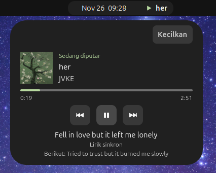
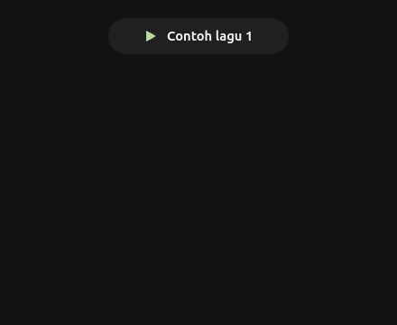

# island-linux

A small floating media widget for GNOME/Ubuntu, with MPRIS playback controls and synced lyrics from LRCLIB.

Inspired by [taskbar-island](https://github.com/xfwil/taskbar-island).

## Screenshots

Expanded media card with playback controls and synced lyrics:



Compact media indicator in the GNOME panel:



## Video demo

[Watch the demo](docs/media/demo.mp4)

## Overview

The lite version includes album artwork, track metadata, playback progress, media controls, synced LRCLIB lyrics, and Japanese romanization. MPRIS and lyrics logic are separate from GTK so they can be tested headlessly. Claude usage cards and launcher features are not included in this version.

The standalone pill starts at 200×40 pixels at the top center, just below the GNOME clock panel. Click or tap it to open the full card. The `Kecilkan` (Minimize) button or Esc returns it to its compact form; pressing Esc while compact closes the application. Ctrl+Q closes the application whenever its window has focus. Enter and Space also activate the pill. Expansion is immediate, without animation or automatic expansion on hover.

You can also integrate the widget with the panel clock using the local extension described below. In that mode, the clock and track title share a pill background in the GNOME panel, without a separate compact window.

## GNOME clock integration

The `Island Linux · Jam dan Media` extension groups the original GNOME clock and a media title button in the top panel. Clicking the clock opens the native calendar; clicking the track title opens the full card. The Minimize button or Esc closes the card window, leaving the compact indicator in the panel. You do not need to keep `python island.py` running separately. Close any existing standalone window to avoid a second pill.

The extension targets GNOME Shell 46–50 and has been tested at runtime on GNOME 50.1. Other versions in that range still need user testing, especially with extensions that modify the panel or clock. The integrated indicator uses native Shell widgets on both Wayland and X11. The full card remains a GTK window, subject to the backend limitations below.

After installing the application dependencies, build the package from the project directory using the GUI virtual environment:

```bash
source .venv/bin/activate
python tools/package_extension.py
gnome-extensions install --force dist/island-linux@local.shell-extension.zip
```

For a new installation on Wayland, log out and back in so GNOME can recognize the local extension. Then enable it:

```bash
gnome-extensions enable island-linux@local
gnome-extensions info island-linux@local
```

If user extensions are disabled globally, open the **Extensions** application, enable user extensions, then enable **Island Linux · Jam dan Media**. The expected status is `ACTIVE`.

Play a track: the panel title updates through MPRIS every two seconds. Click the title to see artwork, controls, and lyrics, then click Minimize. Click the clock to check that the calendar still opens. Disabling the extension restores the clock to its original panel parent:

```bash
gnome-extensions disable island-linux@local
```

The package stores absolute paths to the virtual environment interpreter and project in `launcher.json`. Rebuild and reinstall it if you move either directory. The extension runs `--inspect` asynchronously every two seconds and allows only one open card per extension instance. It does not configure autostart for the standalone application. You can test the card mode separately with `python island.py --panel-card`.

## Installation

The project targets Ubuntu 24.04 LTS with GNOME, Python 3.11+, GTK4, and libadwaita. Ubuntu 24.04 ships with Python 3.12. Use Ubuntu's system Python for the GUI so the `python3-gi` bindings match the interpreter. Create the virtual environment with `--system-site-packages` to access those bindings. Run the application from your desktop session without sudo so it shares the player's session D-Bus.

From the cloned project directory, run:

```bash
sudo apt update
sudo apt install python3-venv python3-gi python3-gi-cairo gir1.2-gtk-4.0 gir1.2-adw-1 gir1.2-gdkpixbuf-2.0 libx11-6 xwayland dbus
python3 -m venv --system-site-packages .venv
source .venv/bin/activate
python -m pip install -r requirements.txt -r requirements-dev.txt
python -m pytest -q
python island.py --selftest
python island.py --inspect
python island.py
```

Play music in Spotify, an MPRIS-enabled browser, or VLC. `--inspect` prints JSON containing the title, artist list, artwork URL, duration, and position in seconds. Pause the player and run it again: the status should become `Paused`. Close all players to see the empty state. This command takes a single snapshot; run it again to see changes.

Installation requires internet access. The following logic tests run without GTK, pydbus, network access, or a display. Use a separate virtual environment to test a minimal setup:

```bash
python3 -m venv .venv-headless
source .venv-headless/bin/activate
python -m pip install -r requirements-core.txt -r requirements-dev.txt
python -m pytest -q
deactivate
```

The `.venv-headless` directory is not needed to run the GUI. Reactivate `.venv` before launching the pill.

## Selftest and CI

The selftest requires only the Python standard library, without pip dependencies:

```bash
python3 island.py --selftest
```

Expect two `PASS` lines, one for MPRIS and one for lyrics, with exit code 0. A failed check produces `FAIL` and exit code 1. Checks cover metadata and time units, player priority, three mocked controls, LRCLIB fallback, caching, lyric line selection, and mocked romanization. The selftest does not exercise a real bus connection, the LRCLIB service, GTK, or the pykakasi dictionary. Use pytest and desktop integration tests for that coverage.

The `--selftest`, `--inspect`, `--demo`, and `--panel-card` modes are mutually exclusive. With no options, the application opens the GUI. `--inspect` requires pydbus and a real session bus but does not open a window.

The [CI workflow](.github/workflows/ci.yml) runs pytest and the selftest on Python 3.11 and 3.12 using Ubuntu 24.04 runners. Runners install only logic and test dependencies. Tests requiring GTK or a display live in `tests/manual_media_ui.py`, outside the `test_*.py` collection pattern, and do not run in headless CI. Local test results do not establish whether a GitHub Actions run has passed; check the repository's Actions tab.

## Project structure

```text
island.py                  # CLI, inspection, selftest, or GUI
island_linux/
  config.py                # Position, theme, fonts, LRCLIB identity
  mpris_client.py          # Player selection, metadata, controls
  lyrics.py                # LRCLIB, LRC parsing, romanization, cache
  selftest.py              # Offline logic checks
  ui/
    pill.py                # Window and D-Bus worker
    card_media.py          # Media card and lyrics/artwork workers
    artwork.py             # Local/HTTP artwork loading
    x11.py                 # X11 position and above hints
tests/                     # Headless unit tests and optional desktop tests
gnome-extension/           # Local clock and media panel extension
tools/package_extension.py # ZIP packaging with local launcher paths
.github/workflows/ci.yml   # Python 3.11/3.12 test matrix
```

## Testing the media card

To inspect the UI without a player or D-Bus:

```bash
python island.py --demo
```

Click the compact pill to open a card labeled `Demo`, with sample tracks, advancing progress, and three controls operating on simulated data. Play/pause stops and resumes demo time; next/previous switches between three sample titles. There is no sample artwork, so the GNOME audio icon serves as a fallback. Close the demo with Ctrl+Q while its window has focus, then run `python island.py` for real metadata. The pill polls once per second in a worker so D-Bus access does not block the UI. When all players close, the compact pill displays `Tidak ada media` (No media), while an open card prompts you to play music. Bus errors appear as messages and trigger automatic retries.

During playback, compare artwork, title, artist, and position with the actual player. Click play/pause and check that status and position follow. Click next/previous and check that the player receives the commands. Buttons are disabled when the player does not support their capabilities. Tab moves focus between buttons; Enter and Space activate them. Try a long title: it should be truncated with an ellipsis, with the full text available in a tooltip. Open another window and check that the pill stays above it.

Artwork supports HTTP/HTTPS, `file://` URIs, and absolute paths. Loading and decoding happen in a separate worker, with a 5 MiB limit and a network timeout. Missing, corrupt, or failed artwork falls back to the audio icon while controls remain available. Artwork responses for a previous track are ignored after a track change. Failed URLs are retried after the URL changes or the application restarts. Artwork is not saved to disk.

The progress bar is informational and does not support seeking. When duration is unavailable, the total time shows `?:??` and progress stays at zero. Position follows MPRIS snapshots every second, rather than a local time estimate. Players may restrict next/previous or update their status after a short delay.

The optional integration test uses a mock player in an isolated D-Bus session. Run it from a desktop terminal with the virtual environment active:

```bash
dbus-run-session -- env ISLAND_TEST_BUS=1 python tests/manual_media_ui.py
```

The test briefly opens a window, loads local fixture artwork, exercises all three controls, checks queued clicks during polling, keyboard focus order, synced lyrics, and romaji, then closes. Expect a `PASS:` line covering D-Bus, artwork, progress, controls, focus, lyrics, romaji, forward/backward seeking, and stale track responses. LRCLIB HTTP requests are mocked with `responses`; this script does not access the internet. It is excluded from headless pytest collection and does not control players in your main desktop session. Some systems print GNOME portal logs as the test session starts or stops.

## Testing lyrics

Update dependencies in the active virtual environment, then launch the offline demo:

```bash
python -m pip install -r requirements.txt -r requirements-dev.txt
python -m pytest -q
python island.py --demo
```

The bottom of the card shows the active lyric line, romaji for Japanese text when available, and a preview of the next line. The demo uses sample text written for this project. Japanese text and romaji appear after a few seconds. Pausing freezes the lyric position; next/previous resets sample time to zero. Lines switch immediately without animation for readability. Long text is truncated with an ellipsis; hover to read the full tooltip.

For real tracks, run `python island.py` and play music in an MPRIS player. With internet access and matching synced lyrics on LRCLIB, lines follow the player position every second. Seek in the actual player to check forward and backward jumps. Pausing should not advance lyrics if the MPRIS position stays fixed. Switch tracks while lyrics are loading to verify that responses for the previous track are ignored.

The client first tries `/api/get` with the first artist, title, and duration when valid, then `/api/search` if synced lyrics are not found. Search candidates must match the normalized title and artist, with a duration difference of at most three seconds when duration is known. This matching may miss metadata with added live/remix labels or different artist names. Without duration, recording versions are harder to distinguish.

The in-memory cache holds up to 64 tracks. Available results are cached for 30 minutes and missing results for 5 minutes. Playback polling does not repeat lyric requests every second. Network failures are retried after about a minute while the same track remains active; rate-limit responses follow `Retry-After` with a small additional delay. Missing lyrics are searched again when returning to a track after cache expiry, or after restarting the application.

The status `Lirik tersedia tanpa timestamp` (Lyrics available without timestamps) means LRCLIB has untimed text, which is not treated as synced lyrics. Instrumental tracks and missing metadata have separate messages. Empty LRC timestamps display `Jeda lirik` (Lyric break) instead of retaining the previous line. The parser supports repeated timestamps and LRC offsets; positive offsets advance the displayed lyrics.

Romanization uses pykakasi in a worker and preserves the original text. Detection uses kana/kanji, so non-Japanese Han text may also be classified as Japanese. Kanji readings and word segmentation may not match the context or the singer's pronunciation.

Change the client identity header through `LRCLIB_USER_AGENT` in `island_linux/config.py`. The default identifies a local build; include a public project URL or valid contact when distributing it. Implementation references: [LRCLIB API](https://lrclib.net/docs.md) and [pykakasi API](https://pykakasi.readthedocs.io/en/latest/api.html).

## Positioning and desktop backends

By default, the entry point tries X11, including XWayland under GNOME Wayland, then falls back to Wayland. EWMH `ABOVE` and position hints are sent through libX11, without requiring wmctrl or layer-shell. The compositor determines the final result. To choose a backend explicitly:

```bash
GDK_BACKEND=x11 python island.py
GDK_BACKEND=wayland python island.py
```

On native Wayland, GTK4 does not provide absolute positioning or always-on-top behavior. A normal window still opens and a warning appears in the terminal. Use XWayland if you need those features. On systems without XWayland, use the native fallback or enable XWayland.

Edit `POSITION` (`top-center` by default, `top-right`, `top-left`, `bottom-center`, `bottom-right`, or `bottom-left`), `OFFSET_X`, `OFFSET_Y`, `COMPACT_WIDTH`, `WIDTH`, fonts, and colors in `island_linux/config.py`, then restart. Window positioning uses the primary X11 monitor. Centered positions ignore `OFFSET_X` so the pill stays centered as its size changes. `OFFSET_Y=40` leaves space for a standard GNOME top panel; adjust it for different panel heights. These window settings are separate from the extension's panel indicator. Mixed-DPI, multiple monitors, and fullscreen behavior need further testing. Always-on-top does not guarantee an overlay above fullscreen applications, the lock screen, or GNOME Overview.

Layout and color decisions are documented in [DESIGN.md](DESIGN.md). GTK tests require a display; unit tests can run headlessly.

## MPRIS behavior

Only `org.mpris.MediaPlayer2.*` services are scanned. Playing players take priority over Paused players. When statuses tie, the previous player is retained to prevent unnecessary switching. On initial selection, service names are sorted for consistent results. Stopped players are not displayed.

`play_pause()`, `next()`, and `previous()` return `False` if no player is available or the capability is unsupported. Command and bus failures raise `MprisError`. Players that disappear during scanning are skipped. The pydbus import is deferred until a real connection is created so mocked tests can run headlessly.

Metadata may be incomplete. Invalid duration and position values are treated as zero, and progress is clamped between 0 and 1. Artwork URLs are passed to the media card's loading worker. Browser support depends on MPRIS integration and the website's metadata.

## Lite version limitations and troubleshooting

- If `import gi` fails, use system Python and create the virtual environment with `--system-site-packages`. Downloaded interpreters or other Python versions may not load the apt-installed bindings.
- If no player is detected, run `python island.py --inspect` from a terminal in the same desktop session. Check that the player or browser exposes an MPRIS service; only Playing and Paused players are selected.
- Duration, position, artwork, and capabilities depend on player data. Missing metadata or infrequent position updates may produce incomplete or delayed information.
- LRCLIB may not have matching lyrics for a track or recording. Automatic romanization has limits with kanji readings, and Han character detection may also match languages other than Japanese.
- Native Wayland does not yet support absolute positioning or always-on-top behavior. XWayland uses compositor hints; fullscreen, GNOME Overview, mixed-DPI, and multiple monitors are not guaranteed.
- Progress does not support seeking. Hover expansion, autostart, and a desktop installer are not included. Open the pill with a click, tap, or keyboard activation; minimize it with the button or Esc. Ctrl+Q closes the application while its window has focus.
- Workers use network timeouts, but process shutdown may wait for an active request to finish. The lyrics cache lasts only for the lifetime of the process.

## Roadmap

Claude usage cards, launcher tiles, automatic hiding in fullscreen, and Wayland layer-shell support are planned after the lite version. Testing evidence and environment limitations are documented in [VALIDATION.md](VALIDATION.md).

## License and credits

MIT. See [LICENSE](LICENSE).

Inspired by [taskbar-island](https://github.com/xfwil/taskbar-island). This project is built for Linux using MPRIS.
